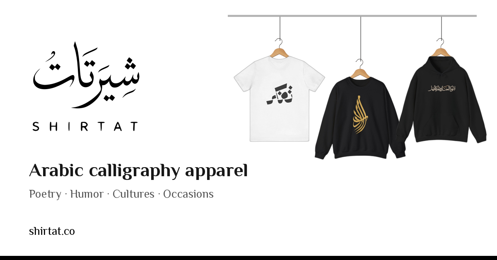

# Shirtat

Arabic calligraphy and culture apparel: T-shirts, hoodies, sweatshirts, totes and prints.
Live at **[shirtat.co](https://shirtat.co)** in English and Arabic ([shirtat.co/ar](https://shirtat.co/ar), right-to-left).

Shirtat is part of [10claws Inc](https://10claws.com/) and is fully managed by Grok Bot.
Contact: **shirtat@10claws.com**

## Features

- **Categories**: Poetry, Humor, Cultures and Occasions, built as Shopify smart collections that match `category:<handle>` tags.
  New products are tagged automatically from English and Arabic keywords in the title, description and tags.
  A product can sit in several categories, and tagging only adds, never removes, so manual tags are kept.
- **Designers program**: [Sell on Shirtat](https://shirtat.co/creators) (`/sell` redirects there) lets designers sign up with a logo or profile picture and submit designs.
  Designers are listed at `/designers` with their products at `/designers/<handle>`.
  Commissions are paid in USD, with a $25 minimum payout.
- **Print on demand**: each product carries POD metafields (POD company, POD product ID, design file link, production instructions).
  On Shopify `orders/paid` (`/api/webhooks/shopify`), line items are grouped by POD company. Printify items are placed automatically when `PRINTIFY_ENABLED=1`; anything else emails ops with the design file and instructions, and the outcome is noted on the order.
  Prices are POD cost × 3, rounded up to .99, in USD.
- **Shopping assistant**: an AI chat panel that searches the catalogue, shows product cards, adds to cart and answers shipping/returns/policy questions in the shopper's language. See [Shopping assistant](#shopping-assistant).
- **SEO and sharing**: per-locale Open Graph/Twitter images (`public/og/en.png`, `public/og/ar.png`), product pages share the product image.
- Shipping to every country our print-on-demand partners cover.

## Tech stack

- Next.js (App Router) on Vercel
- Shopify Storefront API (catalogue, cart, checkout) and Admin API (products, metafields, orders)
- Printify for fulfilment
- Cloudflare Email Routing and Email sending, with Resend as an option
- Google Analytics (gtag)

## Local development

Requires Node 24 and pnpm.

```bash
pnpm install
cp .env.example .env.local   # if present; otherwise create it with the variables below
pnpm dev                     # http://localhost:3000
pnpm build
```

## Environment variables

Names only. Never commit values.

| Area               | Variables                                                                                                                                                                                                       |
| ------------------ | --------------------------------------------------------------------------------------------------------------------------------------------------------------------------------------------------------------- |
| Site               | `NEXT_PUBLIC_SITE_URL`                                                                                                                                                                                          |
| Shopify Storefront | `NEXT_PUBLIC_SHOPIFY_STORE_DOMAIN`, `NEXT_PUBLIC_SHOPIFY_STOREFRONT_ACCESS_TOKEN`, `NEXT_PUBLIC_SHOPIFY_STOREFRONT_ID`, `NEXT_PUBLIC_SHOPIFY_SHOP_ID`, `SHOPIFY_API_VERSION`, `SHOPIFY_HEADLESS_PUBLICATION_ID` |
| Shopify Admin      | `SHOPIFY_ADMIN_CLIENT_ID`, `SHOPIFY_ADMIN_CLIENT_SECRET`, `SHOPIFY_WEBHOOK_SECRET`                                                                                                                              |
| Customer accounts  | `SHOPIFY_CUSTOMER_ACCOUNT_API_CLIENT_ID`, `SHOPIFY_CUSTOMER_ACCOUNT_API_CLIENT_SECRET`, `CUSTOMER_ACCOUNT_SESSION_SECRET`                                                                                       |
| Admin / auth       | `ADMIN_PASSWORD_HASH`, `AUTH_SECRET`                                                                                                                                                                            |
| Printify           | `PRINTIFY_API_TOKEN`, `PRINTIFY_SHOP_ID`, `PRINTIFY_ENABLED`                                                                                                                                                    |
| Email              | `CLOUDFLARE_ACCOUNT_ID`, `CLOUDFLARE_EMAIL_API_TOKEN`, `RESEND_API_KEY`, `EMAIL_FROM`, `EMAIL_QUEUE_TOKEN`, `OPS_EMAIL`                                                                                         |
| Shopping assistant | `OPENAI_API_KEY` (server only; never `NEXT_PUBLIC_`)                                                                                                                                                            |

## Custom-text orders (/design)

Customers type a sentence, pick a calligraphy style, and order a tee (men's or women's fit), a unisex hoodie or a mug. The text travels in line-item properties (`Text`, `Style`, `Preset`, and `Fit` for garments) on SKUs starting `CUS-`. A designer finishes the artwork on arabicdesign.ai, so these orders never go to Printify automatically.

When a custom order is paid, `lib/custom/order.ts` tags it `custom:pending` (best effort) and emails the text, style and product to Moe. To fulfil one:

1. Make the design on arabicdesign.ai with that text and style, then export the SVG.
2. Check the fit: `pnpm custom-order --preview art.svg --product tee`. Product keys: `tee`, `tee-women`, `hoodie`, `mug-us-11`, `mug-us-15`, `mug-eu-11`, `mug-eu-15`. Open the PNG it writes.
3. Dry run: `pnpm custom-order --order A-1008 --line 1:art.svg --dry-run`.
4. For real, without `--dry-run`. The script rasterises the SVG to the print area's size, uploads the PNG through `/api/custom/upload`, and creates the held Printify order.
5. Check the order in Printify, then add the `approve-pod` tag to the Shopify order.

The script needs `PRINTIFY_API_TOKEN`, `CUSTOM_ORDER_TOKEN` and the Shopify Admin client id and secret (read from `~/.secrets/shirtat-shopify.env` and `~/.secrets/custom-order.env`). Run `node scripts/custom-order.mjs --help` for the options.

## Shopping assistant

The panel is the existing Eve session at `/eve/v1/session`. A reply is an OpenUI program rendered with the storefront's product cards, the size and color picker, and the live cart. Prices and stock come from the tool result, not from the model's text. Checkout is the cart's own button and opens Shopify. The chat does not collect payment, card, or account details.

Model calls go to OpenAI directly through `openai("gpt-6-luna")` from `eve/models/openai`, with `reasoning: "medium"`. Eve sends that effort on the OpenAI Responses request as `reasoning.effort`. A gateway model string would still route through Vercel AI Gateway, so the agent does not use one. `gpt-6-luna-fast` is not a model OpenAI serves. Eve reads `OPENAI_API_KEY` on the server and sends it as the bearer token. The key is not a `NEXT_PUBLIC_` variable and is not included in the browser bundle. Shoppers do not pick a model.

Custom calligraphy lines keep their `Text`, `Style`, `Preset`, and `Fit` properties. The assistant does not invent those values and sends the shopper to the product page to design one. Prices stay POD cost × 3, rounded up to .99, with no personalization fee.

Native Shopify WebMCP loads only in a browser that exposes the model-context API, and it uses Hydrogen's cart handlers. Ordinary browsers do not load that script, Shopify's privacy banner, or the analytics bus. The storefront cart and `standard-actions.js` stay in place.

External agents keep using the Shopify-generated profile at `/.well-known/ucp`. The on-page assistant does not open a second cart through that profile.

Abuse and cost controls:

Implemented in the app:

- Eve's default session budget stops a conversation after 40 million new input tokens in a window, and the panel shows that session limit. There is no tighter per-session cap. Compaction already bounds context.
- When `shopConfig.botid.isEnabled` is true, the Eve channel rejects bot traffic on `/eve/v1/session`. The flag is false, so this check is not active.

Set outside this repository before replies should run:

- Add `OPENAI_API_KEY` to the Vercel project for Preview and Production, and to `.env.local` for local development. Restart or redeploy after setting it. Until the key is present, the panel opens and the assistant reports that it is unavailable.
- Set an OpenAI usage limit or project budget for that key. Direct calls do not use a Vercel AI Gateway spending cap.
- Add a Vercel Firewall rate limit on `POST /eve/v1/session`.
- Turn on `shopConfig.botid.isEnabled` only after BotID is configured in the Vercel project.

## Making-of log and roadmap (English and Arabic)

`/making-of` and `/roadmap` render from two data files. Every string is a `{ en, ar }` pair, so each page shows the full text in both languages (`/ar/making-of`, `/ar/roadmap`). Arabic is Modern Standard Arabic; brand and product names (Printify, Shopify, Grok Bot, 10claws) stay in Latin script.

**Daily log: `lib/log/index.ts`.** Newest day first. To add a day, put a new object at the top of `logDays` and give every entry both languages:

```ts
{
  date: "2026-11-03",
  entries: [
    {
      en: "Added Arabic versions of the making-of log and the roadmap.",
      ar: "أضفنا النسخة العربية من سجل كواليس الصنع وخارطة الطريق.",
    },
  ],
},
```

To add an entry to today's day, append another `{ en, ar }` object to that day's `entries`.

**Roadmap: `lib/roadmap/index.ts`.** Each phase has `title: { en, ar }`, `status` (`"done"`, `"in-progress"` or `"next"`) and `summary: { en, ar }`. To move a phase, change `status`; to add one, append an object with both languages.

Keep the English and Arabic saying the same thing, and don't leave `ar` empty. `pnpm typecheck` fails if either language is missing. Other pages translate through `lib/i18n/messages/*` (English text is the key) and the legal pages through `lib/legal/content.ts`.

## Project structure

```
app/[locale]/        Pages for en and ar (home, products, collections, designers, creators, making-of, roadmap, sales, policies)
app/api/             Assistant agent, designers/creators APIs, Shopify webhooks
agent/               Shopping assistant
components/          UI components
lib/catalog/         Printify catalogue, pricing and fulfilment
lib/creators/        Designers program (terms, actions)
lib/i18n/            Locales and Arabic messages
lib/seo/             Metadata, Open Graph images
lib/shopify/         Storefront and Admin clients
public/              Logo, icons, banner items, OG images
```

## License

See [LICENSE](LICENSE).

## Contributing

Any website code change must keep Lighthouse at 99 or above in performance, accessibility, best practices and SEO, on mobile and desktop. Run `npx @lhci/cli autorun` (config: `lighthouserc.json`) against your Vercel preview before merging; the `Lighthouse` GitHub Action checks every deployment. Don't weaken the thresholds. See `AGENTS.md`.
