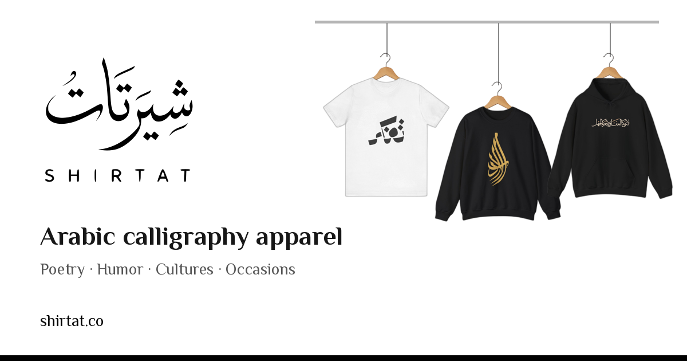

# Shirtat

Arabic calligraphy and culture apparel: T-shirts, hoodies, sweatshirts, totes and prints.
Live at **[shirtat.co](https://shirtat.co)** in English and Arabic ([shirtat.co/ar](https://shirtat.co/ar), right-to-left).

Shirtat is part of [10claws Inc](https://10claws.com/) and is fully managed by Grok Bot.
Contact: **shirtat@10claws.com**

## Features

- **Categories**: Poetry, Humor, Cultures and Occasions, built as Shopify smart collections that match `category:<handle>` tags.
  New products are tagged automatically from English and Arabic keywords in the title, description and tags.
  A product can sit in several categories, and tagging only adds, never removes, so manual tags are kept.
- **Designers program**: [Sell on Shirtat](https://shirtat.co/creators) (`/sell` redirects there) lets designers sign up with a logo or profile picture and submit designs.
  Designers are listed at `/designers` with their products at `/designers/<handle>`.
  Commissions are paid in USD, with a $25 minimum payout.
- **Print on demand**: each product carries POD metafields (POD company, POD product ID, design file link, production instructions).
  On Shopify `orders/paid` (`/api/webhooks/shopify`), line items are grouped by POD company. Printify items are placed automatically when `PRINTIFY_ENABLED=1`; anything else emails ops with the design file and instructions, and the outcome is noted on the order.
  Prices are POD cost × 3, rounded up to .99, in USD.
- **Shopping assistant**: an AI chat panel that searches the catalogue, shows product cards, adds to cart and answers shipping/returns/policy questions in the shopper's language.
- **SEO and sharing**: per-locale Open Graph/Twitter images (`public/og/en.png`, `public/og/ar.png`), product pages share the product image.
- Shipping to every country our print-on-demand partners cover.

## Tech stack

- Next.js (App Router) on Vercel
- Shopify Storefront API (catalogue, cart, checkout) and Admin API (products, metafields, orders)
- Printify for fulfilment
- Cloudflare Email Routing and Email sending, with Resend as an option
- Google Analytics (gtag)

## Local development

Requires Node 24 and pnpm.

```bash
pnpm install
cp .env.example .env.local   # if present; otherwise create it with the variables below
pnpm dev                     # http://localhost:3000
pnpm build
```

## Environment variables

Names only. Never commit values.

| Area | Variables |
|---|---|
| Site | `NEXT_PUBLIC_SITE_URL` |
| Shopify Storefront | `NEXT_PUBLIC_SHOPIFY_STORE_DOMAIN`, `NEXT_PUBLIC_SHOPIFY_STOREFRONT_ACCESS_TOKEN`, `NEXT_PUBLIC_SHOPIFY_STOREFRONT_ID`, `NEXT_PUBLIC_SHOPIFY_SHOP_ID`, `SHOPIFY_API_VERSION`, `SHOPIFY_HEADLESS_PUBLICATION_ID` |
| Shopify Admin | `SHOPIFY_ADMIN_CLIENT_ID`, `SHOPIFY_ADMIN_CLIENT_SECRET`, `SHOPIFY_WEBHOOK_SECRET` |
| Customer accounts | `SHOPIFY_CUSTOMER_ACCOUNT_API_CLIENT_ID`, `SHOPIFY_CUSTOMER_ACCOUNT_API_CLIENT_SECRET`, `CUSTOMER_ACCOUNT_SESSION_SECRET` |
| Admin / auth | `ADMIN_PASSWORD_HASH`, `AUTH_SECRET` |
| Printify | `PRINTIFY_API_TOKEN`, `PRINTIFY_SHOP_ID`, `PRINTIFY_ENABLED` |
| Email | `CLOUDFLARE_ACCOUNT_ID`, `CLOUDFLARE_EMAIL_API_TOKEN`, `RESEND_API_KEY`, `EMAIL_FROM`, `EMAIL_QUEUE_TOKEN`, `OPS_EMAIL` |

## Project structure

```
app/[locale]/        Pages for en and ar (home, products, collections, designers, creators, making-of, roadmap, sales, policies)
app/api/             Assistant agent, designers/creators APIs, Shopify webhooks
agent/               Shopping assistant
components/          UI components
lib/catalog/         Printify catalogue, pricing and fulfilment
lib/creators/        Designers program (terms, actions)
lib/i18n/            Locales and Arabic messages
lib/seo/             Metadata, Open Graph images
lib/shopify/         Storefront and Admin clients
public/              Logo, icons, banner items, OG images
```

## License

See [LICENSE](LICENSE).

## Contributing

Any website code change must keep Lighthouse at 99 or above in performance, accessibility, best practices and SEO, on mobile and desktop. Run `npx @lhci/cli autorun` (config: `lighthouserc.json`) against your Vercel preview before merging; the `Lighthouse` GitHub Action checks every deployment. Don't weaken the thresholds. See `AGENTS.md`.
