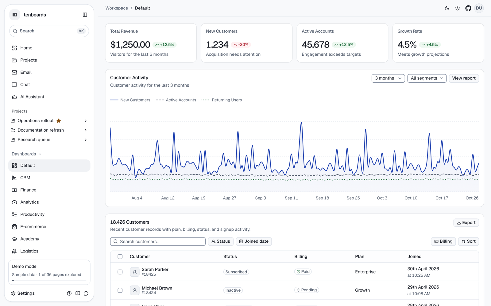
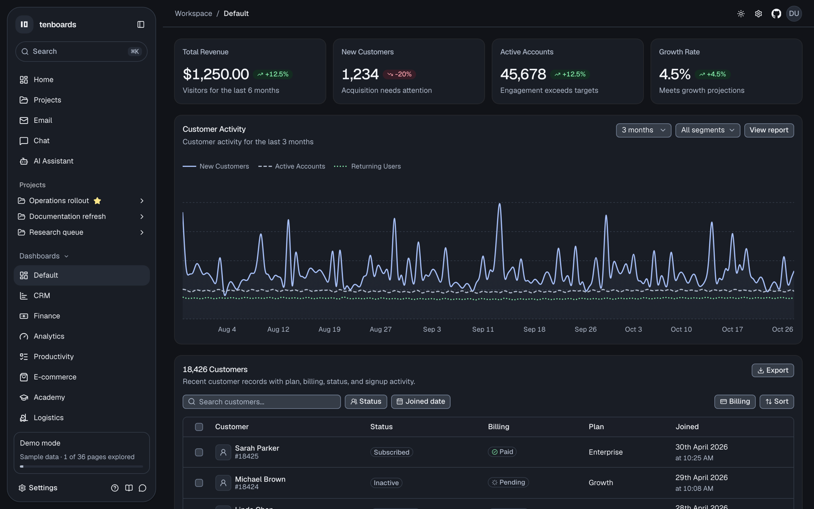
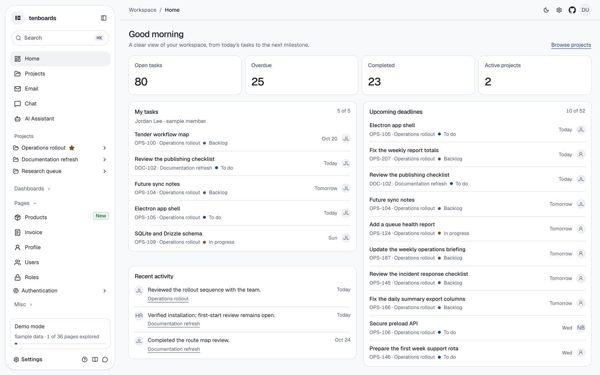
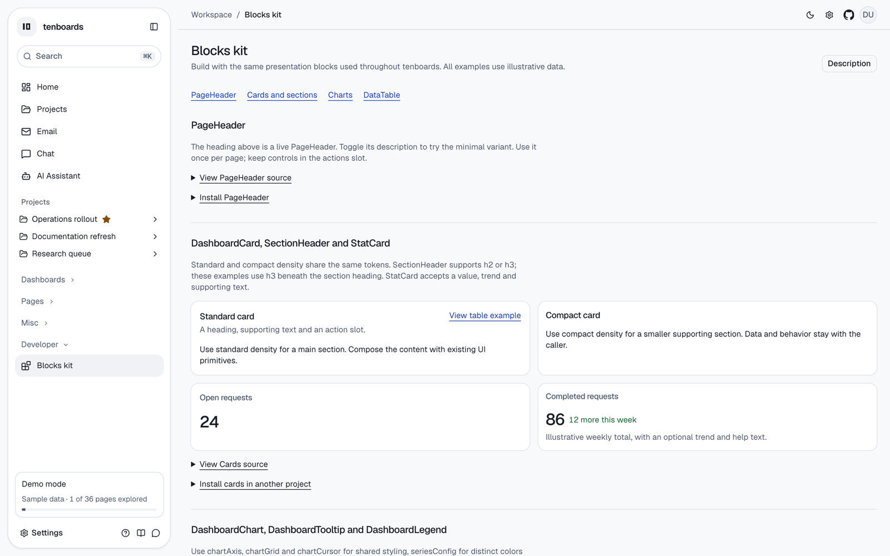
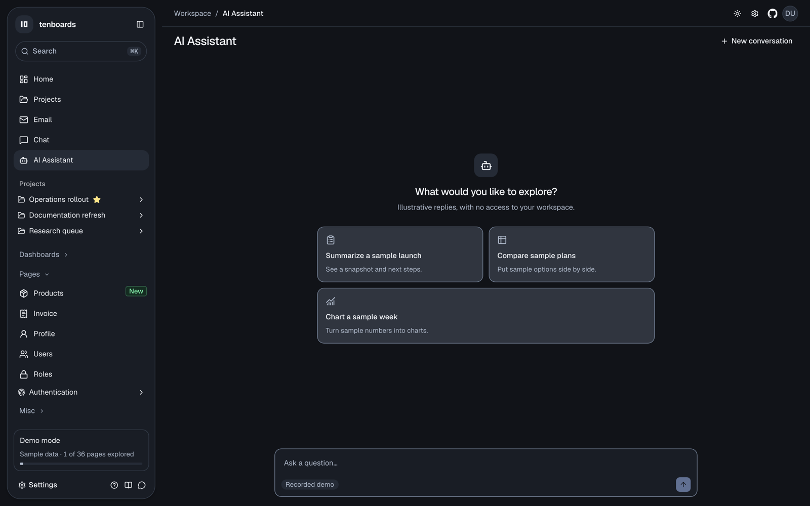

# Shirtat admin

Owner and designer dashboards for Shirtat. This directory is its own Vercel project (`apps/admin`). It is adapted from [tenboards](https://github.com/moeghashim/tenboards), an MIT TanStack Start template. The tenboards theme, Tailwind setup and block installer stay inside this app. Do not install those blocks into the storefront: a block install applies the theme globally.

Signed-in owners land on the SEO plan. Designers land on `/dashboard/designers`. Public sign-up is closed. See [docs/deploy.md](docs/deploy.md) for the Vercel project settings and Neon env vars.

The sections below are the inherited tenboards adopter guide. Demo dashboards from the template are not routed in this app. The blocks kit, generators, guardrails and Agent Skills are.

# tenboards

An agent-first, MIT-licensed dashboard template built with TanStack Start, React 19, TypeScript, Tailwind CSS v4 and shadcn/ui on Base UI.

Point Codex or Claude Code at a clone and ask for a dashboard or page. Agents get an adopter guide, Agent Skills, page generators and public blocks, so the on-system path is the shortest one. `npm run check` and `npm run verify:page` fail on off-system UI.

**[Project homepage](https://tenboards.mohanadgh.workers.dev/)** · **[Live demo](https://tenboards.mohanadgh.workers.dev/dashboard/default)** · [Blocks kit](https://tenboards.mohanadgh.workers.dev/dashboard/kit) · [llms.txt](https://tenboards.mohanadgh.workers.dev/llms.txt) · [Changelog](CHANGELOG.md)



| | |
| --- | --- |
|  |  |
|  |  |

## Build with an agent

Start a fresh Codex or Claude Code session in your clone and ask, for example, “add a Sales dashboard with revenue KPIs and a top-products table” or “add a Vendors page listing vendors”.

- **[AGENTS.md](AGENTS.md)** gives the stack, file map, build loop and invariants. Claude Code imports it through `CLAUDE.md`.
- **Agent Skills:** [tenboards-build-ui](.agents/skills/tenboards-build-ui/SKILL.md) covers generators, blocks and page verification. [tenboards-connect-data](.agents/skills/tenboards-connect-data/SKILL.md) covers typed reads, migrations, seeds and demo/database parity. Codex discovers `.agents/skills/`; Claude Code discovers the symlinks in `.claude/skills/`.
- **Generators:** `npm run new:dashboard sales` or `npm run new:page vendors` scaffold a route, navigation entry, guarded loader, typed reads and fixtures.
- **Blocks:** import `PageHeader`, `DashboardCard`, `StatCard`, `DataTable`, `DashboardChart` and friends from `@/components/blocks`. Every block has a live example at `/dashboard/kit`.
- **Guardrails:** `npm run check` fails on raw colors, arbitrary sizes and look-alike cards. `npm run verify:page -- /dashboard/<slug>` captures light/dark × desktop/mobile and fails on axe violations and console or hydration errors. All 37 catalog routes pass.
- **Outside this repo:** agents can read `/llms.txt` and `/llms-full.txt`. Other shadcn projects can install blocks with `npx shadcn add https://YOUR-HOST/r/stat-card.json`. Installing a block also applies the tenboards theme globally, so review the CSS changes.

Generated database reads are illustrative stubs. Use the data skill and `npm run data:parity` before claiming a real database integration.

## Quick start

Use Node 22+ and npm. No environment variables or database are required.

```sh
git clone https://github.com/moeghashim/tenboards.git
cd tenboards
OPENUI_TELEMETRY_DISABLED=1 DO_NOT_TRACK=1 npm install
npm run dev
```

Open <http://localhost:3000/> for the homepage or <http://localhost:3000/dashboard/default> for the demo. Keep OpenUI install telemetry disabled as shown.

| Command | Purpose |
| --- | --- |
| `npm run dev` | Development server on port 3000 |
| `npm run build` / `npm run preview` | Production build; preview the compiled Worker locally |
| `npm run check` | Biome, design guardrails, skills, registry and llms freshness |
| `npm run typecheck` | TypeScript |
| `npm run verify:page -- <route>` / `-- --all` | Four-state screenshots, axe and runtime checks |
| `npm run new:dashboard <slug>` / `new:page <slug>` | Scaffold a page |
| `npm run registry:build` / `npm run llms:build` | Regenerate registry JSON and LLM docs |
| `npm run db:generate` / `db:migrate` / `db:seed` / `data:parity` | Optional Postgres workflow |

See the [full command list](docs/reference.md#commands).

## What's included

- **Ten dashboards:** Default, CRM, Finance, Analytics, Productivity, E-commerce, Academy, Logistics, Infrastructure and Patient Monitoring.
- **Workspace:** Home, Projects (Overview, Board, List, Timeline and Files), an AI Assistant, Mail, Chat, Invoice, Products, Users, Roles, Profile, auth pages and system states.
- **Design system:** compact tokens in [DESIGN.md](DESIGN.md), light/dark themes, presets, a floating sidebar, a ⌘K palette and layout settings.
- **Generative dashboards (v0.10):** send **Show sample blocks** in recorded mode to see public cards, a read-only table and line/bar/area charts in a responsive grid. Send **Show revenue dashboard** for guarded fixture-backed data with no keys. Snapshot captions and observation timestamps use readable UTC labels; monthly and reporting-period categories retain their domain meaning. The full-width canvas supports model-free refresh and targeted replace/add edits with stable panels. Five audited series, available range and all segment only; state clears when you leave. Try **Show analytics dashboard**, **Show finance dashboard**, then choose a panel and **Make this a bar chart**; see [Assistant documentation](docs/assistant.md).
- **Optional integrations:** [Postgres data layer](docs/data-layer.md) with Drizzle, [Better Auth](docs/auth.md), [AI Assistant providers](docs/assistant.md) and [Cloudflare Workers deployment](docs/deploy.md).

The live site is a zero-config demo with sample data and auth off. Adopters connect and verify their own database by following the [deployment quick path](docs/deploy.md#quick-path).

## Homepage

`/` redirects to the SEO plan for owners and demo mode, and to `/dashboard/designers` for a signed-in designer. The template homepage components are not part of this app.

## Documentation

- [Reference](docs/reference.md): commands, previews, visual QA, data layer, auth and per-milestone notes
- [Design guardrails](docs/design-guardrails.md) · [Data layer](docs/data-layer.md) · [Auth](docs/auth.md) · [Assistant](docs/assistant.md) · [Deploy](docs/deploy.md)
- [Changelog](CHANGELOG.md) and [releases](https://github.com/moeghashim/tenboards/releases). v0.1–v0.10 are released; v0.9.0 is the agent-first release, v0.9.1 adds the project homepage and v0.10.0 adds generative dashboards in the AI Assistant.

## Contributing

Upstream contributions follow [dev/MAINTAINERS.md](dev/MAINTAINERS.md) and [CONTRIBUTING.md](CONTRIBUTING.md). PLAN.md and its Decisions log govern the project.

## Provenance and license

MIT. Imported from [arhamkhnz/tanstack-shadcn-admin-dashboard](https://github.com/arhamkhnz/tanstack-shadcn-admin-dashboard) (Studio Admin), revision [`81e5ef1`](https://github.com/arhamkhnz/tanstack-shadcn-admin-dashboard/commit/81e5ef1391b68c176154faba0c9ac7b0023ecbaf). Copyright © 2026 Mohammed Arham Khan. The original MIT notice is preserved in [LICENSE](LICENSE), alongside the tenboards copyright. Upstream contributor guidance is archived at [docs/upstream-AGENTS.md](docs/upstream-AGENTS.md).
